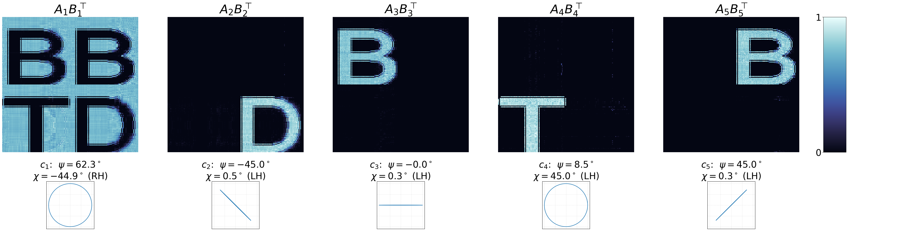

# pyBBTD

Decompose images with a vector or a matrix at each pixel into a few interpretable components.

Hyperspectral images hold a vector at each pixel; covariance-valued images, as in diffusion
tensor imaging or polarimetric radar, hold a matrix. pyBBTD writes such an image as a sum
of a few **terms**, each a **spatial map** (where the term is) times a **signature** (the
vector or matrix it contributes to each pixel). Mathematically, these are block term tensor
decompositions.



**Documentation, tutorials and API reference: <https://scbarreto.github.io/pyBBTD/>**

## Install

```bash
pip install git+https://github.com/scbarreto/pyBBTD
```

Python 3.11 or newer is required.

## Example

```python
import numpy as np

from pybbtd import Stokes
from pybbtd.datasets import load_bbtd_board
from pybbtd.visualization import plot_stokes_terms

np.random.seed(0)
T = load_bbtd_board()  # 160 x 160 pixels, one Stokes vector (4 numbers) each

model = Stokes(T.shape[:2], R=5, L=25)
model.fit(T, init="kmeans", max_iter=5000, max_admm=2, rel_tol=1e-5, abs_tol=1e-7, admm_tol=1e-5)

A, B, C = model.factors
plot_stokes_terms(A, B, C, R=5, L=25)
```

## Models

| Model | Data at each pixel | Tensor shape | Fitting |
|---|---|---|---|
| `BTD` | several numbers (channels) | (I, J, K) | ALS |
| `CovLL1` | a covariance matrix, stored as a vector | (I, J, K²) | AO-ADMM |
| `Stokes` | a Stokes vector (polarization) | (I, J, 4) | AO-ADMM |
| `BBTD` | a matrix, or a covariance matrix | (I, J, K, M) | ALS, or AO-ADMM for covariances |

Every model checks whether its terms are guaranteed to be unique, and offers random,
SVD or K-means starting points. See
[Choosing a model](https://scbarreto.github.io/pyBBTD/models/index.html).

## Repository layout

```
src/pybbtd/       the package: models, solvers/, visualization/, datasets/
tests/            the test suite (pytest)
docs/             the documentation site; the tutorials are executed notebooks
scripts/          maintenance scripts (re-running the notebooks)
```

## Contributing

Development setup, tests, linting and building the docs are described in
[CONTRIBUTING.md](CONTRIBUTING.md).

## Papers

- Cov-LL1: <https://ieeexplore.ieee.org/abstract/document/10446019>
- BBTD: <https://hal.science/hal-05059862/>

## License

GNU General Public License v3.0, see [LICENSE](LICENSE).
